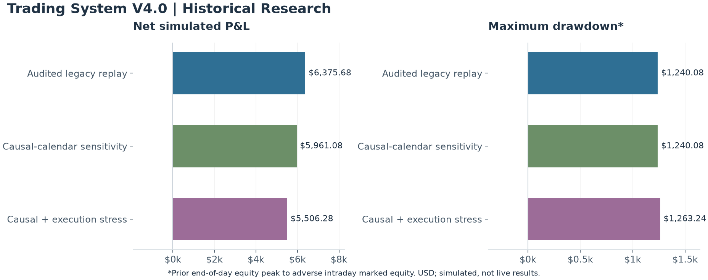

# Trading System V4.0

**State-aware risk research and simulation integrity**

I developed a portfolio simulator with persistent risk-state concepts and comparative stress analysis. This showcase emphasizes the distinction between simulated behavior and integration behavior, including an audit that identified gaps between them.

This is a curated engineering and historical-results showcase. The implementation remains private.

## Historical results

Period: **January 2–October 1, 2026**. These are preserved audit results for the version snapshot reviewed on October 13, 2026. They are development-sample simulations, not live performance or untouched holdout tests. The three rows are alternative replays of the same period and must not be added together.

**Snapshot scope:** these figures describe an earlier audited V4 configuration. Later revisions use a different configuration; the figures below are not measurements of those later revisions. The audit also found simulation/integration parity gaps. No operational-readiness claim is made.

| Replay | Net P&L | Maximum drawdown* | Trades | Win rate | Profit factor |
|---|---:|---:|---:|---:|---:|
| Audited legacy replay | $6,375.68 | $1,240.08 | 109 | 56.88% | 1.73 |
| Causal-calendar sensitivity | $5,961.08 | $1,240.08 | 108 | 56.48% | 1.68 |
| Causal + execution stress | $5,506.28 | $1,263.24 | 108 | 55.56% | 1.64 |

## Measurement and assumptions

- Net P&L is the sum of whole-position results after modeled transaction costs. A win requires positive whole-position net P&L; profitable partial executions alone do not constitute a win. Profit factor is total positive net P&L divided by the absolute sum of negative net P&L.
- **Maximum drawdown*** is the largest decline from the highest previously completed end-of-day equity to adverse intraday marked equity. It is not a drawdown measured from the highest intraday equity. The legacy replay also records end-of-day peak-to-trough drawdown of $1,216.24.
- Legacy replay costs: micro gold commission $1.92 per contract round trip with two ticks of modeled exit slippage; micro index commission $1.40 per contract round trip with zero modeled stop slippage. Costs in the preserved implementation differ from some configuration documentation; these are the effective replay assumptions.
- The causal-calendar sensitivity selects the micro index contract using the prior completed session rather than the current full day. The final row additionally applies micro index commission of $1.90 per contract round trip, two stop/market slippage ticks, one-tick entry trade-through, and session-end flattening at the open. Gold assumptions remain unchanged. This is a partial execution sensitivity, not a fully stressed portfolio.
- Minute bars do not establish intrabar event order, queue priority, latency or executable fills. The legacy row contains a known future-information issue in contract selection. The alternate rows address that calendar issue but do not remove all simulation limitations.
- Model selection used the inspected period. Preserved arithmetic is checked against the audit artifacts; a new market-data replay was not run for this showcase. No prospective paper or live performance is published.

## Engineering focus

- Unified portfolio accounting across two market streams.
- Reproducible configuration and regression checks.
- Cost-aware reporting with explicit drawdown definitions.
- Audits that distinguish documentation errors, simulation assumptions and integration limitations.

## Portfolio context

[Version 2.0](https://github.com/miahaa/trading-system-v2-showcase) · [Version 3.0](https://github.com/miahaa/trading-system-v3-showcase) · [Version 4.0](https://github.com/miahaa/trading-system-v4-showcase) · [Version 7.0](https://github.com/miahaa/trading-system-v7-showcase)

These projects use different configurations, datasets and research objectives. Their results are not a controlled version ranking. Historical simulation results do not predict future returns.
