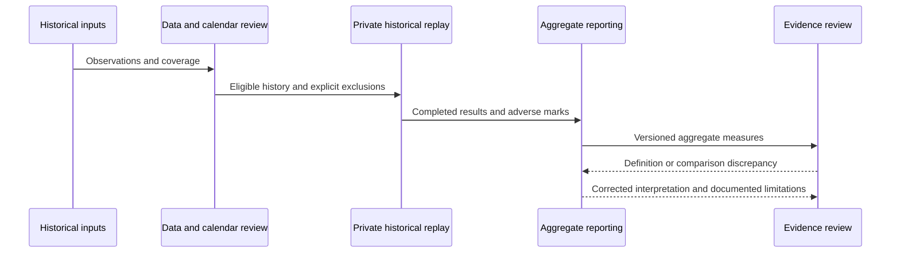

# Engineering notes · V4.0

## Design scope

Separating a simulated protection from evidence that an integration implements it. This document explains the logical responsibilities visible in the research evidence. It does not assert a distributed architecture, throughput target, service-level guarantee or deployment certification.

A protection can exist in a simulator while an integration lacks the state needed to use it. A performance table alone cannot demonstrate that the surrounding system behaves the same way.

## Responsibility boundaries

| Layer | Input responsibility | Output responsibility | Assurance boundary |
|---|---|---|---|
| Historical inputs | Market observations and research-period coverage | Time-indexed observations suitable for the replay | Presence of a record does not prove its original delivery latency |
| Calendar and temporal checks | Contract mapping and available history | Explicit eligible or missing-window outcomes | A retrospective mapping must not be mistaken for causal information |
| Private decision component | Version-specific internal inputs | Internal events consumed by the experiment | Rules and parameters are intentionally absent from this public description |
| Simulation | Chronological events and declared cost scenario | Modeled outcomes and equity marks | Minute bars cannot determine all intrabar ordering |
| Reporting | Completed-position totals and marked equity | Net P&L, position count and drawdown summaries | Aggregation must preserve definitions and version boundaries |
| Evidence review | Preserved outputs and comparison scenarios | Supported conclusions plus unresolved limitations | Reproduced arithmetic does not establish deployability or a future edge |

## Logical sequencing

This is a conceptual research sequence, not a network protocol or an operational event schema.

## Public data contract

The published `metrics.json` contains aggregates only. Its conceptual contract is:

| Field group | Meaning | Reporting invariant |
|---|---|---|
| Version and scope | Identifies the historical snapshot or inherited baseline | Results cannot silently move between versions |
| Period | Inclusive research-calendar coverage | Partial years remain labeled as partial years |
| Scenario | Cost/calendar comparison applied to that replay | Alternative scenarios are not additive |
| Net P&L | Sum after modeled costs | Descriptive simulation output, not cash earnings |
| Drawdown | Prior end-of-day peak to adverse marked equity | Must not be relabeled as intraday-peak drawdown |
| Position count | Count of completed simulated positions | Must not be substituted with fill or partial-execution count |
| Verification and limitations | What the saved evidence supports | Unmeasured performance stays unpublished |

The table is documentation of aggregate fields, not an internal schema or interface specification.

## Evidence review matrix

| Question | Current evidence | Interpretation |
|---|---|---|
| Do headline aggregates agree with preserved artifacts? | Checked during showcase preparation | Supports consistency of the published numbers |
| Are transaction-cost assumptions explicit? | Documented per scenario | Supports interpretation, not certainty about actual fills |
| Can changing data assumptions affect the result? | Labeled calendar/cost sensitivities | The reported result depends on the experiment definition |
| Were fresh replays run for this presentation? | No | This is a presentation and evidence-review update |
| Are future returns or operational guarantees established? | No | Historical evidence is insufficient for those claims |

## Failure modes and engineering lessons

1. **Temporal leakage:** a historical selection can use information from later in the same period. Calendar comparisons expose this risk without changing the public result into a new strategy claim.
2. **Unit mismatch:** fills, partial executions and whole positions are different counting units. A metric must state which one it uses.
3. **State mismatch:** a historical simulation may evolve state differently from an integration. A replay result cannot certify that integration.
4. **Definition drift:** a drawdown measured from end-of-day peaks differs from one measured from intraday peaks, even when both are called maximum drawdown.
5. **Selection dependence:** inspected periods and overlapping research observations cannot be treated as untouched independent tests.
6. **Missing evidence:** a missing measurement is a publication boundary, not a zero value or a positive assurance claim.

## Version-specific interpretation

The historical audit identified a mismatch between simulated state-dependent behavior and integration state availability. The older results in this showcase must remain tied to that audited simulation snapshot. Later configuration changes cannot inherit the earlier table as their measured performance.

## Development priorities

These are future evidence requirements, not completed capabilities: stronger execution-sequence validation, explicit simulation/integration parity checks, and prospective observations under a frozen measurement protocol. They do not propose public changes to the private trading policy.

[Overview](../README.md) · [Methodology](METHODOLOGY.md) · [Results](RESULTS.md)
